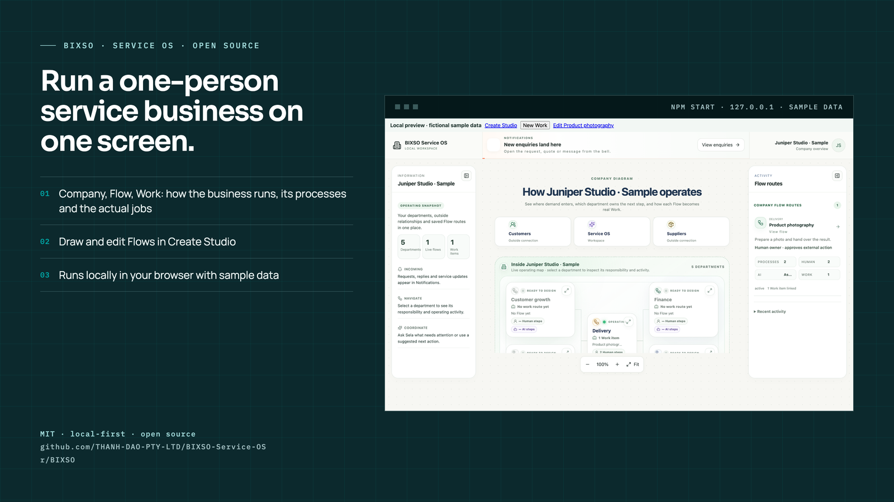

# BIXSO Service OS



A local web app for a one-person business. **Company** shows how your business works. **Flow** is a reusable process you can edit in Create Studio. **Work** is a concrete job linked to a Flow step.

## Who it's for

- **Builders:** developers and agencies building workspace tools for solo service businesses (photographers, designers, trades) can start from the Company → Flow → Work model, the Flow editor and the local storage layer.
- **Service business owners:** try the sample company in your browser and tell us which step of your real work it doesn't fit.

<!-- bixso-os-origin:start -->
## Where this comes from

These rules come from **[Serviceplace](https://serviceplace.com.au)**, a local services marketplace that BIXSO builds and runs. This repository is the open concept and a lite reference implementation of its rules: plain functions, local files and no accounts. The product adds what a real service needs, such as accounts, hosting and support, and it is still being built.

Ideas and changes made here are reviewed for Serviceplace as well. See this project's [roadmap](docs/ROADMAP.md) and [how BIXSO OS is run](https://github.com/THANH-DAO-PTY-LTD/.github/blob/main/GOVERNANCE.md).
<!-- bixso-os-origin:end -->

## Try the preview

Use Node.js 24 and npm. Clone the repository or download and unpack the [prerelease source](https://github.com/THANH-DAO-PTY-LTD/BIXSO-Service-OS/releases). In the source directory, run:

```sh
npm ci
npm start
```

Open the loopback URL printed in the terminal. On the sample Company, open **Product photography**, then **View work: Prepare product photo**. Select the fictional job and save a handover note. Use **Create Studio** to draw or edit a Flow. **Save** stores a draft, and **Activate locally** makes the Flow available for **New Work**.

## Limits of this preview

Use fictional records. The app stores them in the current browser profile and local URL. It has no import, export or backup feature in this preview and does not read earlier CLI JSON. The Flow Designer demo proposes a fixed example graph. It makes no model calls and performs no Work. Keep the development server on loopback.

## Try it and help shape it

[Share feedback](https://github.com/THANH-DAO-PTY-LTD/BIXSO-Service-OS/issues) about setup or a step that didn't fit your workflow. A fictional example helps others reproduce it. A challenge we'd like to build with contributors is an opt-in assistant that performs one clearly defined Work item and returns a result the owner can inspect. Propose a task, its expected output and how the owner can tell it succeeded.

Run `npm test` and `npm run build` before opening a pull request. See [CONTRIBUTING](CONTRIBUTING.md) and the [private security reporting channel](SECURITY.md).

<!-- bixso-os-family:start -->
## BIXSO OS family

Small, local-first, MIT-licensed tools for running real work, each built from the rules of a BIXSO product.

| Project | What it does |
| --- | --- |
| [BIXSO Service OS](https://github.com/THANH-DAO-PTY-LTD/BIXSO-Service-OS) (this project) | Run a one-person service business: Company, Flow and Work in a local web app. |
| [BIXSO Sourcing OS](https://github.com/THANH-DAO-PTY-LTD/BIXSO-Sourcing-OS) | B2B sourcing workflows from RFQ to delivered order, with a receipt for every step. |
| [BIXSO Consulting OS](https://github.com/THANH-DAO-PTY-LTD/BIXSO-Consulting-OS) | An evidence-first record of a consulting engagement. |
| [BIXSO Construction OS](https://github.com/THANH-DAO-PTY-LTD/BIXSO-Construction-OS) | An outdoor or landscape job from site survey to handover. |
| [BIXSO Paperwork OS](https://github.com/THANH-DAO-PTY-LTD/BIXSO-Paperwork-OS) | One shared record of a paperwork matter between a client and their professionals. |
| [BIXSO Travel OS](https://github.com/THANH-DAO-PTY-LTD/BIXSO-Travel-OS) | Trip plans where every suggestion explains itself, plus traveller-host meetups. |
| [BIXSO Sport OS](https://github.com/THANH-DAO-PTY-LTD/BIXSO-Sport-OS) | Community pickup games with a fair waitlist, check-in and results. |
| [BIXSO Social OS](https://github.com/THANH-DAO-PTY-LTD/BIXSO-Social-OS) | Connections and a trust ledger that moves only on independent receipts. |
| [BIXSO Academy OS](https://github.com/THANH-DAO-PTY-LTD/BIXSO-Academy-OS) | Learning evidence where AI gives feedback and people verify. |

Release news, questions and ideas: [r/BIXSO](https://www.reddit.com/r/BIXSO/).

## Work with BIXSO

Want this set up for your business, or shaped around how your team actually works? BIXSO provides business workflow advisory and implementation. See [bixso.ai](https://bixso.ai/?utm_source=github&utm_medium=readme&utm_campaign=bixso-os&utm_content=service-os).
<!-- bixso-os-family:end -->

## License

[MIT](LICENSE) · Copyright (c) 2026 Thanh Dao Pty Ltd. [Dependency notices](docs/PROVENANCE.md).

The software is provided under the MIT license. Nothing in that license or in this repository excludes, restricts or modifies any right or remedy you have under the Australian Consumer Law, or any other law, that cannot lawfully be excluded.

BIXSO and the BIXSO logo are trademarks of Thanh Dao Pty Ltd. The MIT license covers the code, not the names or logo; see [TRADEMARKS.md](TRADEMARKS.md).
